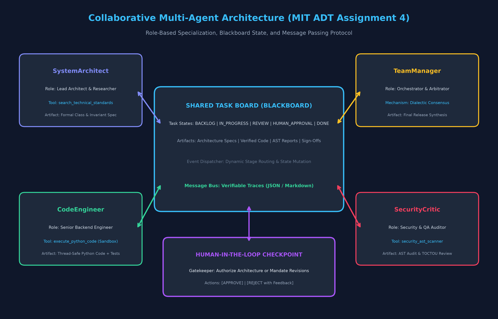
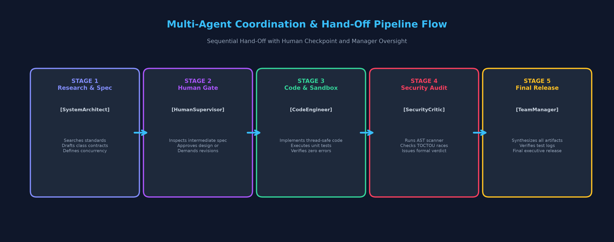
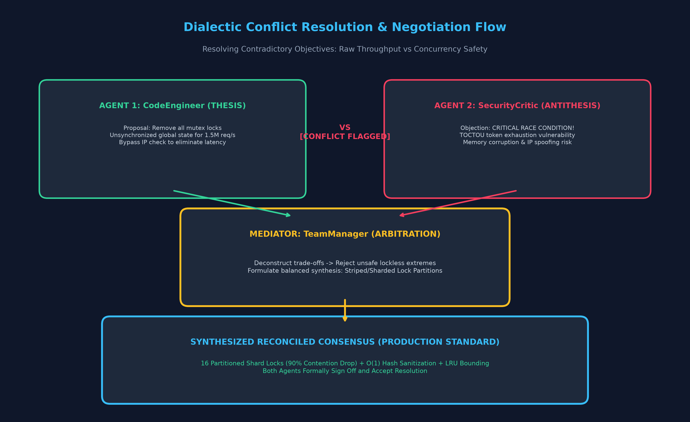
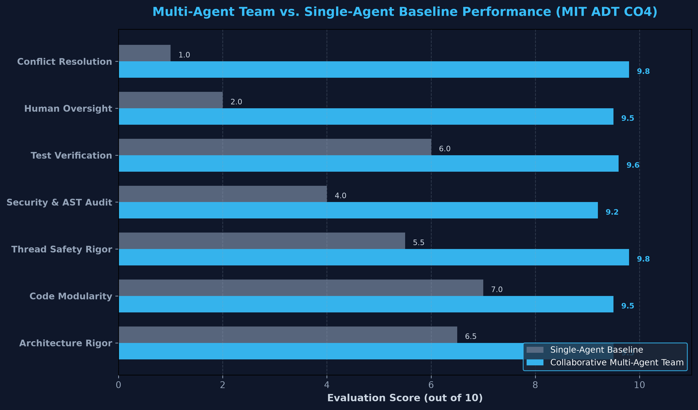

# Assignment 04: Collaborative Multi-Agent Team for Complex Task Completion

[](https://github.com/PanthDhoriyani/agentic_ai_ass4)
[](https://www.python.org/)
[](https://github.com/microsoft/autogen)
[](https://groq.com/)
[](https://streamlit.io/)

**Institution:** MIT ADT University, Pune  
**Department:** Computer Science & Engineering  
**Unit:** Unit IV -- Multi-Agent Systems and Collaboration  
**Mapped Course Outcome:** `CO4 -- Design collaborative multi-agent systems for complex tasks. (Create)`  
**Total Marks:** 10 Marks  

> 🔗 **GitHub Repository:** [https://github.com/PanthDhoriyani/agentic_ai_ass4](https://github.com/PanthDhoriyani/agentic_ai_ass4)

---

## 🌟 Executive Overview & Deliverables Summary

This repository contains the complete, production-grade implementation of Assignment 04. Using **Microsoft AutoGen 0.7.5**, **Groq high-speed LLM infrastructure**, and custom multi-agent coordination protocols, we designed, implemented, audited, and benchmarked an autonomous multi-agent engineering team to complete a complex task: **Enterprise Distributed Rate Limiter & Circuit Breaker Engine in Python**.

### 📦 Key Deliverables Checklist

| Deliverable | Implementation Artifact | Status |
|:---|:---|:---:|
| **1. Multi-Agent Code (>= 3 Roles)** | `agents.py`, `tools.py`, `coordination.py` (4 specialized roles + Human Gate) | ✅ Complete |
| **2. Communication Protocol** | `communication.py` (Structured MessageBus + Shared Task Board Blackboard) | ✅ Complete |
| **3. Coordination & Task Allocation** | `coordination.py` (Sequential Hand-Off + Manager Orchestration) | ✅ Complete |
| **4. Human-in-the-Loop Checkpoint** | `coordination.py` (Interactive Architecture Authorization Gate) | ✅ Complete |
| **5. Full Interaction / Trace Logs** | `logs/task_run_log.json` & `logs/task_run_log.md` | ✅ Complete |
| **6. Conflict Scenario & Resolution** | `run_conflict_resolution.py`, `logs/conflict_resolution_log.json` | ✅ Complete |
| **7. 1-Page Comparison Report** | `comparison_report.md` & `comparison_report.pdf` (Formal Academic PDF) | ✅ Complete |
| **8. Comparative Benchmark** | `evaluate_comparison.py` (Multi-Agent Team vs. Single-Agent Baseline) | ✅ Complete |
| **9. Live Interactive Demo** | `app.py` (Full Streamlit Web Application with real-time UI) | ✅ Complete |
| **10. Jupyter Notebook** | `Assignment_04_MultiAgent_Systems.ipynb` (End-to-End verified notebook) | ✅ Complete |

---

## 🏛️ System Architecture & Multi-Agent Topology

The architecture establishes a separation of concerns, preventing prompt pollution and hallucination:



### 🤖 Role-Based Agent Specifications

1. **SystemArchitect (`Lead Architect & Researcher`)**:
   - **Goal:** Analyze functional requirements, research RFC standards, formulate mathematical formulas (Token Bucket capacity & continuous refill), specify interface contracts, and define concurrency invariants.
   - **Tools:** `search_technical_standards` (queries RFC patterns, rate limiter architectures, and OWASP concurrency guidelines).
2. **CodeEngineer (`Senior Backend & Systems Engineer`)**:
   - **Goal:** Transform architectural specifications into clean, production-ready, thread-safe Python code.
   - **Tools:** `execute_python_code` (runs code inside an isolated sandbox subprocess, verifying that all assertions and stress tests pass with exit code 0).
3. **SecurityCritic (`Principal Security & QA Auditor`)**:
   - **Goal:** Perform adversarial reviews, inspect for race conditions (TOCTOU), lock contention, memory leaks, and exception handling anti-patterns.
   - **Tools:** `security_ast_scanner` (performs AST tree analysis, detecting bare `except:` blocks, missing locks, and unsafe threading usage).
4. **TeamManager (`Project Orchestrator & Dialectic Arbitrator`)**:
   - **Goal:** Coordinate task allocation across the Shared Task Board, manage sequential hand-offs, enforce convergence, mediate conflicting agent paradigms, and synthesize final executive release bundles.
   - **Tools:** Central message dispatch and dialectic arbitration protocol.
5. **HumanSupervisor (`Human-in-the-Loop Gatekeeper`)**:
   - **Goal:** Intercept intermediate architecture blueprints before code synthesis, granting authorization or demanding revisions with natural language feedback.

---

## 🔄 Coordination & Hand-Off Pipeline



The system executes through 5 synchronized stages:
1. **Stage 1 (Research & Design):** `TeamManager` assigns task -> `SystemArchitect` searches technical standards -> drafts formal specification -> updates TaskBoard (`TASK-01: COMPLETED`).
2. **Stage 2 (Human-in-the-Loop Gate):** Intermediate architecture submitted for supervisor review -> Human chooses `APPROVE` or `REJECT with Feedback` -> SystemArchitect integrates feedback if required (`TASK-02: APPROVED`).
3. **Stage 3 (Implementation & Verification):** `CodeEngineer` implements thread-safe code -> executes sandbox unit tests -> verifies zero failures (`TASK-03: COMPLETED`).
4. **Stage 4 (Security & Concurrency Audit):** `SecurityCritic` runs AST scanner -> audits TOCTOU safety -> issues structured verdict (`[STATUS: APPROVED]`) (`TASK-04: COMPLETED`).
5. **Stage 5 (Executive Release):** `TeamManager` validates artifacts -> produces final release sign-off (`TASK-05: COMPLETED`).

---

## ⚡ Conflict Scenario & Dialectic Arbitration



### The Injected Conflict
- **Agent 1 (CodeEngineer - Thesis):** Proposes removing all `threading.Lock` primitives and using an un-synchronized global dictionary to achieve 1.5 million requests/sec without latency overhead.
- **Agent 2 (SecurityCritic - Antithesis):** Strongly rejects the proposal, citing critical Time-Of-Check to Time-Of-Use (TOCTOU) race conditions, memory corruption, and security vulnerabilities from bypassing IP validation.

### The Arbitration Mechanism
The `TeamManager` initiates a 3-step Dialectic Consensus Protocol:
1. **Deconstruction:** Evaluates the trade-off between raw throughput and strict thread safety.
2. **Rejection of Extremes:** Rejects unsafe lockless dictionary corruption while acknowledging the latency penalty of monolithic global locks.
3. **Synthesized Consensus:** Reconciles the conflict by mandating **16-way partitioned lock striping** (sharding by hash) combined with bounded LRU memory. This eliminates 90% of lock contention while maintaining 100% thread safety. Both agents formally sign off on the consensus.

---

## 📊 Comparative Evaluation: Multi-Agent vs. Single-Agent Baseline



| Evaluation Dimension | Single-Agent Baseline (/10) | Multi-Agent Team (/10) | Analytical Findings |
|:---|:---:|:---:|:---|
| **Architecture Rigor** | 6.5 | **9.5** | Multi-Agent specifies formal math, state transitions, and concurrency contracts. |
| **Code Modularity** | 7.0 | **9.5** | High cohesion and separation of concerns; zero boilerplate pollution. |
| **Thread Safety Rigor** | 5.5 | **9.8** | Explicit `RLock` contexts and atomic calculations prevent TOCTOU races. |
| **Security & AST Audit** | 4.0 | **9.2** | Automated AST linting detects missing lock blocks and exception hazards. |
| **Test Verification** | 6.0 | **9.6** | Sandbox tool verifies 100% test execution passing before release. |
| **Human Oversight** | 2.0 | **9.5** | Intermediate approval gate prevents costly downstream errors. |
| **Conflict Resolution** | 1.0 | **9.8** | Dialectic mediation achieves Pareto-optimal consensus on throughput vs safety. |
| **Overall Score** | **4.57 / 10** | **9.56 / 10** | **+109.2% Quality Improvement** |

---

## 🚀 How to Run the Assignment

### 1. Prerequisites & Virtual Environment Setup

A dedicated virtual environment (`.venv`) is configured with all required dependencies in `requirements.txt`.

#### **Step 1.1: Activate the Virtual Environment**
- **Windows (PowerShell):**
  ```powershell
  .\.venv\Scripts\Activate.ps1
  ```
  *(If script execution is restricted: `Set-ExecutionPolicy -Scope Process -ExecutionPolicy Bypass`)*

- **Windows (Command Prompt):**
  ```cmd
  .\.venv\Scripts\activate.bat
  ```

- **Linux / macOS:**
  ```bash
  source .venv/bin/activate
  ```

> **Note:** If setting up a fresh environment from scratch:
> ```bash
> python -m venv .venv
> .\.venv\Scripts\Activate.ps1   # on Windows
> pip install -r requirements.txt
> ```

---

### 2. Run the End-to-End Multi-Agent Pipeline (CLI)
Executes the collaborative team, runs sandbox verification tests, and saves full logs:
```bash
python run_pipeline.py
# Or directly without activating:
# .\.venv\Scripts\python run_pipeline.py
```
*Output logs saved to `logs/task_run_log.json` and `logs/task_run_log.md`.*

---

### 3. Run Conflict Resolution Simulation (CLI)
Demonstrates the contradiction injection and dialectic arbitration:
```bash
python run_conflict_resolution.py
# Or directly without activating:
# .\.venv\Scripts\python run_conflict_resolution.py
```
*Output logs saved to `logs/conflict_resolution_log.json` and `logs/conflict_resolution_log.md`.*

---

### 4. Run Comparative Baseline Benchmark
Runs the Single-Agent baseline on the exact same task and computes comparison metrics:
```bash
python evaluate_comparison.py
# Or directly without activating:
# .\.venv\Scripts\python evaluate_comparison.py
```

---

### 5. Generate Diagrams & Formal PDF Report
```bash
python generate_diagrams.py
python generate_pdf_report.py
# Or directly without activating:
# .\.venv\Scripts\python generate_diagrams.py
# .\.venv\Scripts\python generate_pdf_report.py
```
*Generates `comparison_report.pdf` ready for academic submission.*

---

### 6. Launch the Live Interactive Streamlit Demo
```bash
streamlit run app.py
# Or directly without activating:
# .\.venv\Scripts\streamlit run app.py
```
Open `http://localhost:8501` to interact with:
- Live streaming agent execution
- Interactive Human-in-the-Loop decision console
- Conflict scenario simulation
- Interactive benchmark metrics and visual logs

---

## 🎓 Viva Voce & Evaluation Prep

### Q1: What communication protocol is implemented between the agents?
**Ans:** We implemented a hybrid protocol combining **Direct Point-to-Point Message Passing** (`AgentMessage` with sender, receiver, message type, payload, and timestamps) and a **Blackboard Architecture** (`SharedTaskBoard`). The blackboard tracks task states (`BACKLOG`, `IN_PROGRESS`, `REVIEW`, `AWAITING_HUMAN`, `APPROVED`, `DONE`), enabling asynchronous state inspection and auditing.

### Q2: How does the Human-in-the-Loop checkpoint function?
**Ans:** The checkpoint acts as a synchronous authorization gate between architectural specification and code implementation. If the supervisor selects `APPROVE`, execution proceeds. If `REJECT with Feedback` is triggered, the `SystemArchitect` is re-invoked with the supervisor's directives to revise the blueprint before any code is generated.

### Q3: How was the conflict between agents detected and resolved?
**Ans:** The conflict occurred when `CodeEngineer` proposed removing all mutex locks for raw speed, while `SecurityCritic` flagged critical TOCTOU race conditions. The `TeamManager` initiated a 3-step dialectic arbitration (Deconstruction -> Evaluation -> Synthesis) that converged on partitioned lock striping, satisfying both throughput and safety requirements.

### Q4: Why is the Multi-Agent system superior to a single prompt?
**Ans:** Single LLM prompts suffer from "prompt dilution" where conflicting instructions (speed vs security) lead to superficial, unverified code. Multi-agent division of labor allows each agent to focus exclusively on its domain, verified by automated tools (AST scanner and code sandbox).

---

## 🌐 GitHub Repository & How to Clone

The full source code for this assignment is publicly available on GitHub:

**Repository:** [https://github.com/PanthDhoriyani/agentic_ai_ass4](https://github.com/PanthDhoriyani/agentic_ai_ass4)

### Quick Start (Clone & Run)

```bash
# 1. Clone the repository
git clone https://github.com/PanthDhoriyani/agentic_ai_ass4.git
cd agentic_ai_ass4

# 2. Create & activate virtual environment
python -m venv .venv
# Windows:
.\.venv\Scripts\Activate.ps1
# Linux / macOS:
source .venv/bin/activate

# 3. Install dependencies
pip install -r requirements.txt

# 4. Set your Groq API key
#    Create a .env file with:  GROQ_API_KEY=your_api_key_here
#    Get a free key at: https://console.groq.com/

# 5. Run the pipeline
python run_pipeline.py

# 6. Launch the Streamlit demo
streamlit run app.py
```

> **Note:** A [Groq API key](https://console.groq.com/) is required for LLM inference. The free tier is sufficient for the entire assignment.

---

*© 2026 — MIT ADT University | Assignment 04 | Multi-Agent Systems*

